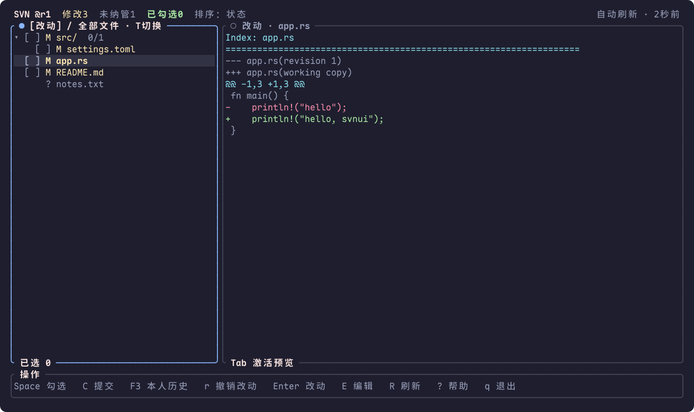
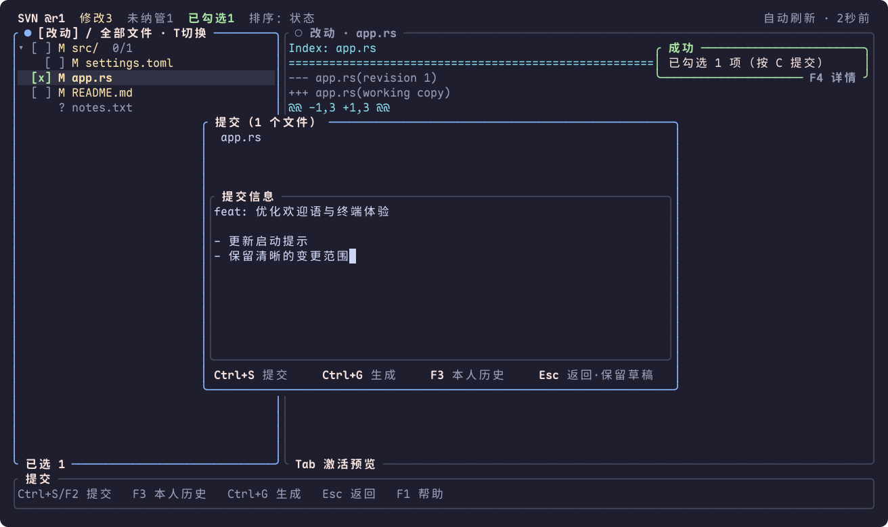
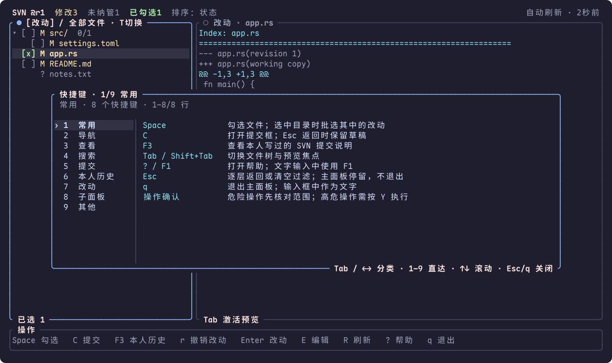

# svnui

在终端里查看 SVN 改动、勾选文件、写提交说明。

svnui 是独立的 Subversion TUI 客户端，基于 Rust 和 [ratatui](https://github.com/ratatui/ratatui)。
用文件树选择范围，在右侧阅读 diff，再进入提交框完成提交；日常操作可以全程使用键盘。

[下载安装](#下载与安装) · [快速上手](#快速上手) · [快捷键](#tui-键位) · [AI 提交说明](#ai-生成提交信息) · [Q&A](docs/qa.md) · [更新日志](CHANGELOG.md)



> 界面示例来自本地演示 SVN 仓库，由实际 TUI 渲染生成，使用虚构文件与提交说明。

## 可以做什么

| 日常任务 | 在 svnui 中完成 |
|---|---|
| 看清改动范围 | 改动树 / 全部文件切换，搜索路径，阅读文本、图片和办公文档 |
| 只提交需要的文件 | 勾选文件或批选目录；搜索、折叠后保留有效勾选 |
| 写好提交说明 | 多行编辑与草稿保留；复用本人历史说明，或让本机 Codex 生成候选 |
| 追踪与处理问题 | 仓库历史、版本对比、blame、冲突处理与工作副本体检 |
| 在项目间切换 | Ctrl+P 切换工作副本，也可浏览远端目录并检出 |

普通使用无需 Rust、Yazi 或图标字体。SVN 操作需要本机安装 `svn` 并配置仓库访问权限。

## 下载与安装

当前正式版 **[0.8.0](https://github.com/jc-p/svnui/releases/tag/0.8.0)**，提供 macOS 11+ 的双架构安装包。
下载二进制无需 Rust；使用 SVN 功能需要本机有 `svn`，可先运行 `svn --version --quiet` 检查。
Linux 等其他系统请[从源码构建](#从源码构建)。

### 一条命令安装或升级（推荐）

```bash
curl -fsSL https://raw.githubusercontent.com/jc-p/svnui/main/install.sh | bash
```

脚本识别当前终端架构，下载官方最新正式 Release，校验 SHA256 和二进制版本，
再安装到 `~/.local/bin/svnui`。不需要 sudo，不修改 shell 配置；下载、校验或新程序启动失败时保留旧安装。

首次安装后，将用户目录加入当前终端的 PATH 并核对版本：

```bash
export PATH="$HOME/.local/bin:$PATH"
hash -r
svnui --version
```

需要永久生效时，将 `export PATH="$HOME/.local/bin:$PATH"` 加入 `~/.zshrc`（Bash 用户用 `~/.bashrc`）。
指定版本或安装目录：

```bash
curl -fsSL https://raw.githubusercontent.com/jc-p/svnui/main/install.sh | bash -s -- --version 0.8.0 --bin-dir "$HOME/.local/bin"
```

不想执行在线脚本，可以使用下面的官方安装包，按 [Q&A 的手动安装步骤](docs/qa.md#manual-install) 校验并安装。
GitHub 网页或脚本域名连接失败时，Q&A 也提供已验证的 GitHub CLI 下载方式。

### 直接下载安装包

| Mac 类型 | `uname -m` | 0.8.0 安装包 |
|---|---|---|
| Apple Silicon（M 系列） | `arm64` | [下载 ARM64](https://github.com/jc-p/svnui/releases/download/0.8.0/svnui-0.8.0-aarch64-apple-darwin.tar.gz) |
| Intel，或运行在 Rosetta 下的终端 | `x86_64` | [下载 x86_64](https://github.com/jc-p/svnui/releases/download/0.8.0/svnui-0.8.0-x86_64-apple-darwin.tar.gz) |

[SHA256SUMS](https://github.com/jc-p/svnui/releases/download/0.8.0/SHA256SUMS) ·
[源码提交与产物清单](https://github.com/jc-p/svnui/releases/download/0.8.0/manifest.json) ·
[查看最新 Release](https://github.com/jc-p/svnui/releases/latest)

选择 `svnui-版本-架构.tar.gz`，Release 页面里的 **Source code** 是源码，不是可直接运行的程序。
不确定架构时先执行 `uname -m`，不要凭文件名猜。

### Homebrew

```bash
brew tap jc-p/svnui
brew install jc-p/svnui/svnui
```

若 Homebrew 提示第三方 tap 未受信任，再按提示执行 `brew trust --tap jc-p/svnui`。
升级前先核对 formula 提供的版本：

```bash
brew update
brew info jc-p/svnui/svnui
brew upgrade jc-p/svnui/svnui
```

GitHub Release 与 Homebrew tap 分别发布；如果 formula 尚未提供需要的版本，使用上面的安装脚本或直接下载。
不混用安装来源时更容易升级；已有多个 `svnui` 时见 [Q&A：升级后仍运行旧版](docs/qa.md#old-version)。

### 从源码构建

需要 Rust 1.88+、Git，以及使用 SVN 功能时所需的 `svn`。

```bash
git clone https://github.com/jc-p/svnui.git
cd svnui
cargo build --release --locked
mkdir -p "$HOME/.local/bin"
./install-local.sh --no-build --bin-dir "$HOME/.local/bin"
```

这会构建 `main` 的当前源码；复现特定发布版本时，在构建前先 `git checkout 0.8.0`。
首次构建可能下载依赖；使用 `--locked` 保持依赖版本一致。

### 本地源码更新

```bash
mkdir -p "$HOME/.local/bin"
./install-local.sh --bin-dir "$HOME/.local/bin"
```

`install-local.sh` 离线构建当前源码，校验安装结果与 PATH；它与下载预编译包的 `install.sh` 用途不同。
依赖未缓存时先执行 `cargo fetch --locked`。省略 `--bin-dir` 时安装到 `/usr/local/bin`，可能需要 sudo。
更新完成后退出旧界面，重新运行 `svnui tui`。

## 快速上手

进入已有 SVN 工作副本，检查环境后打开界面：

```bash
cd /path/to/your/working-copy
svnui probe
svnui tui
```

`probe` 应识别出 SVN 路径、版本和工作副本根。首次连接失败时，按 [认证与证书说明](docs/qa.md#authentication) 处理后再进入。
也可直接运行 `svnui`；交互式终端默认进入 TUI，不在工作副本中时进入项目选择或检出界面。

第一次提交只需四步：

1. 用 `↑↓` / `j/k` 选择文件，在右侧阅读 diff；`Tab` 切到预览后可翻页。
2. 按 `Space` 勾选要提交的文件；选中目录时会批选其中的文件改动。未纳管项先用 `a` 添加。
3. 按 `C` 打开提交框，写说明。`Enter` 换行，`Ctrl+G` 生成候选，`F3` 找回自己以前写过的说明。
4. 核对文件清单和说明，按 `Ctrl+S` / `F2` 提交。`Esc` 返回时保留本次会话的草稿。

如果只提交部分文件，请先勾选。未勾选时按 `C` 会自动选择全部可提交改动，提交前务必核对文件清单。

**主面板只用 `q` 退出。** `Esc` 逐层返回或清空过滤；输入框中的 `q`、`?` 都是文字。
有疑问按 `F1` 查看帮助，非输入状态也可按 `?`。

## 界面与操作

### 提交说明可以慢慢写



返回文件树不会清空草稿。主面板按 `F3` 只读查看本人已提交的说明；提交框内按 `F3` 可将选中的原说明插入光标处，保留已有内容，不自动提交。
首次输入 SVN 用户名，按作者精确匹配；`N` 查找更早记录。完整操作见 [提交与本人历史](docs/tui-keymap.md#提交框)。

### 快捷键按任务分类查找



`Tab` / `Shift+Tab` 或 `←→` 切分类，`1`–`9` 直达；`↑↓` / `j/k` 阅读，`PgUp/PgDn` 翻页。
宽窗口显示分类侧栏与键位表，窄窗口自动折行。`Esc` / `q` 只关闭帮助，返回原界面。

### 外观、提示与文件预览

内置 Catppuccin、Nord、Tokyo Night、终端配色和无色模式，设置方法见 [主题配置](docs/theme.md)。
`●` / `○` 表示焦点，无需专用字体。普通提示在右上角，`F4` 查看全文；分支工作流内用 `Shift+F4`。

本地文件可独立预览，无需先进入 SVN 工作副本：

```bash
svnui preview ./notes.txt
svnui preview ./diagram.png
svnui preview ./report.xlsx
```

支持文本、常见图片、CSV/TSV、Excel 和 Word（.docx）；默认上限 2 MiB，超出时显示原因。
也可预览远端 SVN 目录：`svnui preview "https://svn.example.com/repo/trunk/project/"`。
详见 [预览操作与限制](docs/tui-keymap.md#预览区)。

## TUI 键位

先记住这些，其余随时按 `F1` 查找：

| 任务 | 按键 | 说明 |
|---|---|---|
| 选择 / 阅读 | `↑↓` / `j/k`、`Tab` | 移动光标，切换文件树与预览 |
| 选择提交范围 | `Space`、`Ctrl+A` | 勾选当前项；全选当前筛选内改动 |
| 提交 | `C` → `Ctrl+S` / `F2` | 编辑说明，再确认提交 |
| 本人说明 | `F3` | 主面板只读；提交框内可插入草稿 |
| 搜索 / 刷新 | `/`、`R` / `F5` | 搜路径；重新扫描工作副本 |
| 仓库历史 / 项目 | `L`、`Ctrl+P` | 查版本改动；切换工作副本 |
| 帮助 / 返回 / 退出 | `F1`、`Esc`、`q` | 帮助；逐层返回；退出主面板 |

注意大小写：`r` 丢弃本地改动，`R` 刷新；`d` 删除版本项及本地文件，`D` 保留本地文件。
危险操作会先列范围确认，执行前请核对清单。

[TUI 完整键位与边界说明](docs/tui-keymap.md) · [Yazi 插件键位（可选）](docs/keymap.md)

## AI 生成提交信息

提交框按 `Ctrl+G` 生成可编辑候选，不自动提交。未启用 AI 或请求失败时使用本地规则，并显示来源或失败原因。
推荐复用已经安装、登录的 Codex CLI：

```bash
codex --version
codex login status
svnui llm --preset codex
```

最后一条只打印示例，不写配置。将以下内容合并到配置文件的 `[llm]` 段：

```toml
[llm]
enabled = true
provider = "codex"
codex_bin = "codex"
timeout_secs = 90
send_diff = false
```

默认配置路径是 `~/.config/svnui/config.toml`，已有 `[llm]` 时修改该段，避免重复。
无需另填模型地址和 Key，Codex CLI 读取自己的配置与登录。默认只发送勾选文件路径和状态；`send_diff = true` 才附带差异正文。

完整配置、数据范围、超时与其他模型通道见 [AI 提交说明指南](docs/ai-commit.md)。

## 文档与开发

- [TUI 快捷键与操作说明](docs/tui-keymap.md)：选择范围、提交、历史、冲突与确认框。
- [命令行、构建与开发](docs/advanced.md)：分支操作、参数、缓存与 feature 开关。
- [命令参考](docs/cli.md) · [主题配置](docs/theme.md) · [发布流程](PUBLISH.md)。
- [Q&A](docs/qa.md)：安装、认证、旧版本、复制输入、模型与发布中遇到的问题。
- [专项故障排查](docs/troubleshooting.md)：Yazi、树冲突和 SVN 路径。

## License

[MIT](LICENSE)
